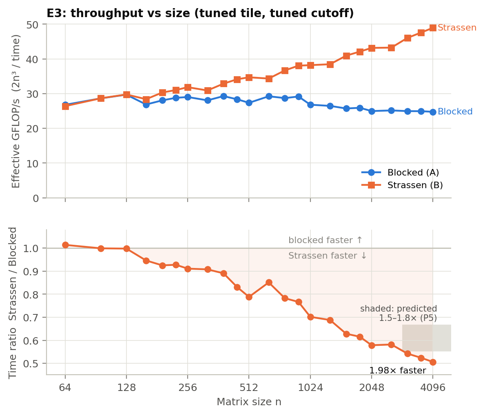
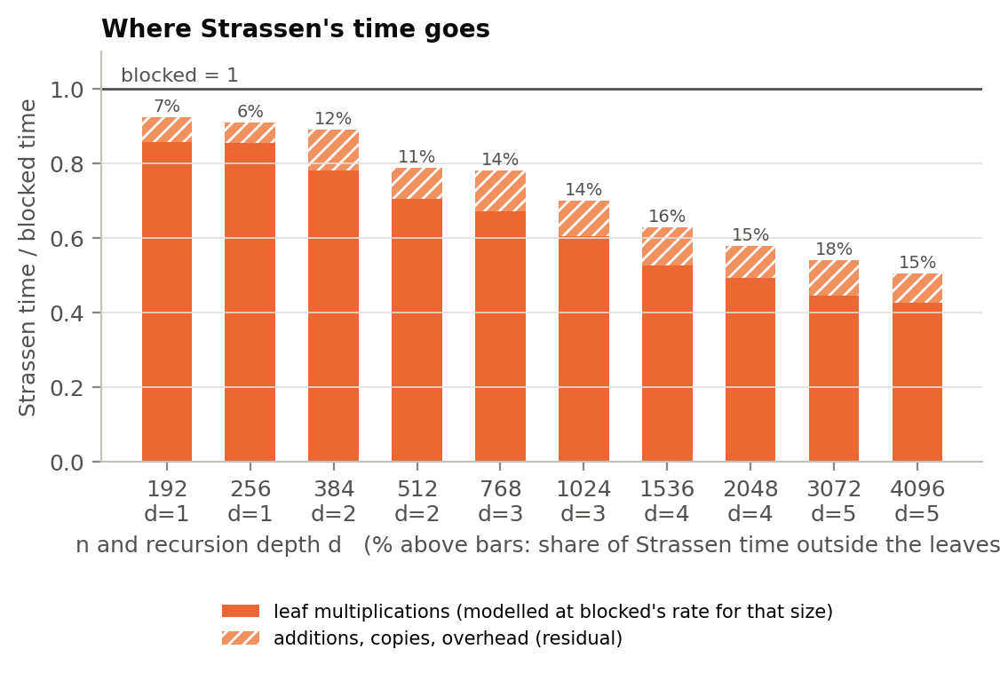
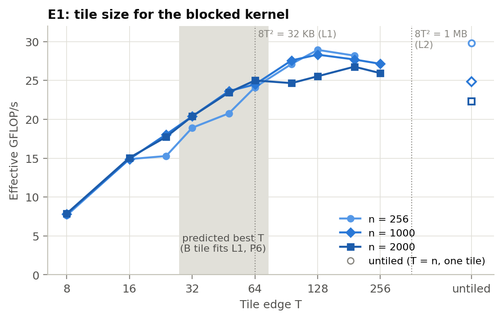
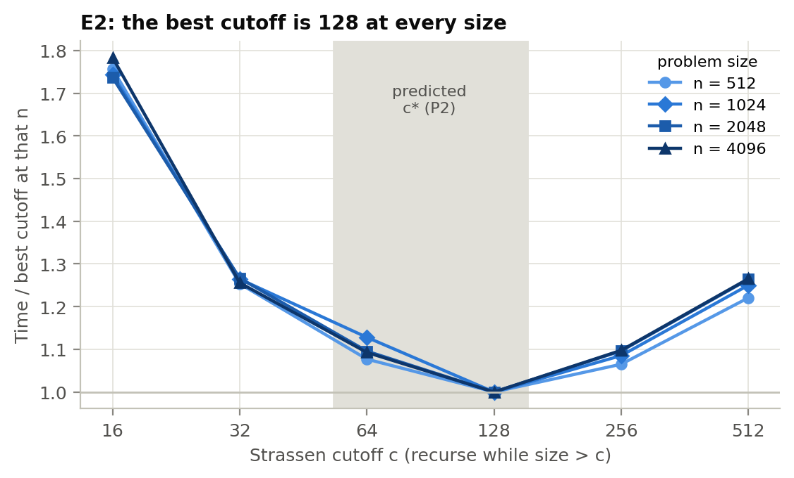
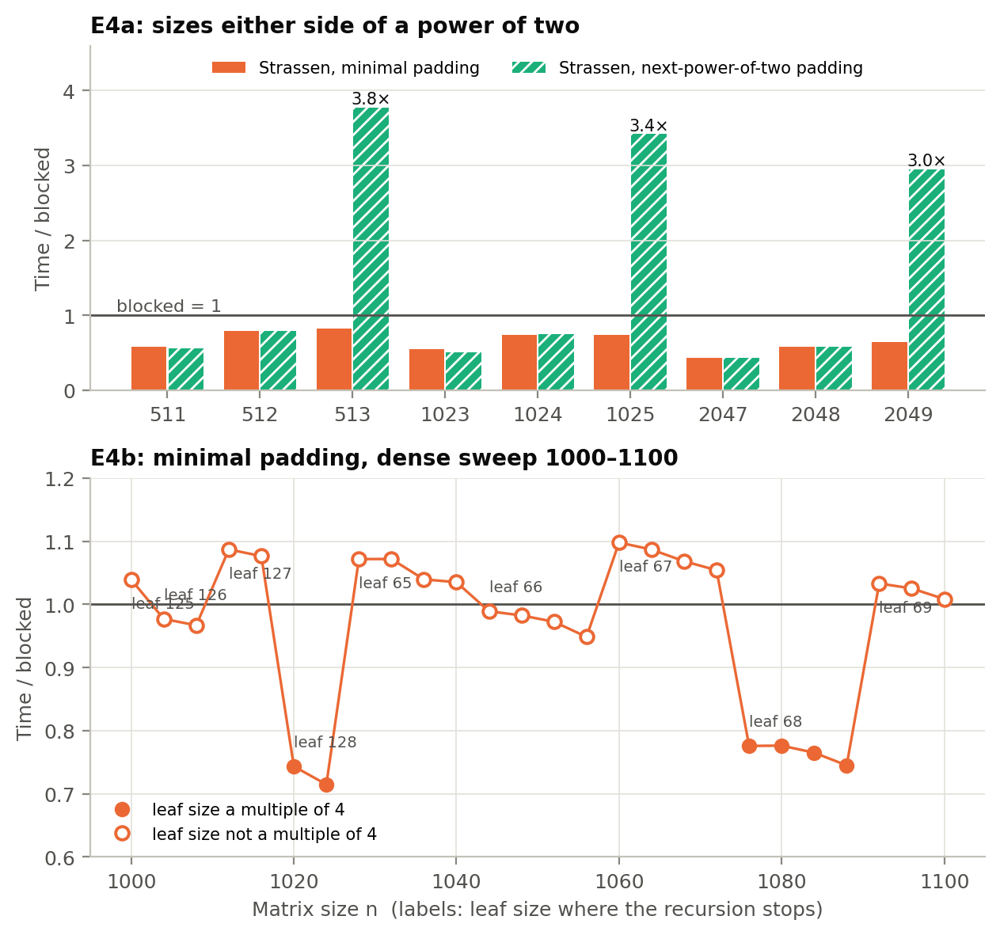
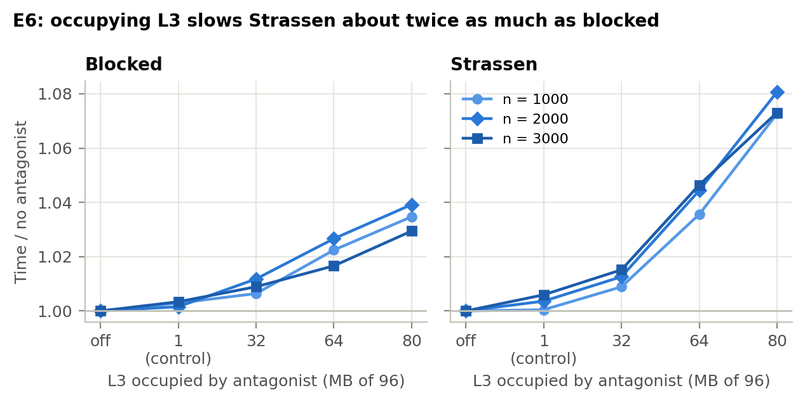
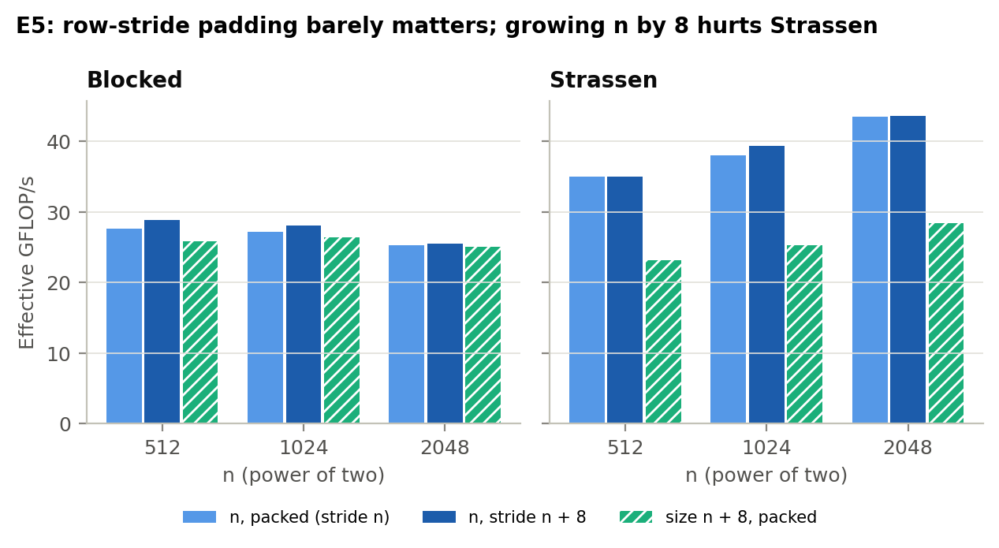
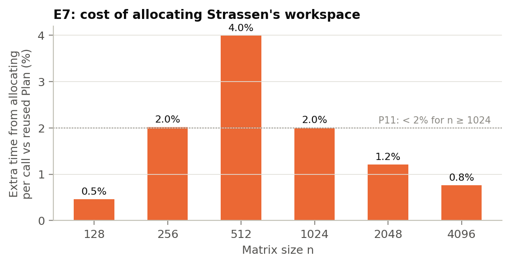
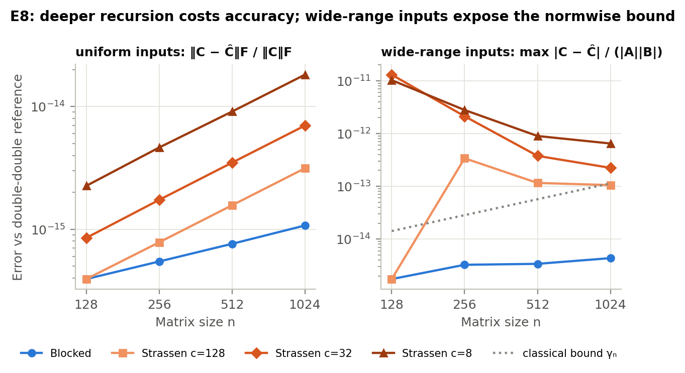

# 4. Results and analysis

Times are medians of 7 repetitions with the tuned parameters (T = 128, c = 128). "Effective GFLOP/s" is 2n³ divided by time, which puts both algorithms on one scale.

## 4.1 Scaling and crossover

*Figure 1. E3: effective throughput against n (top), and Strassen's time as a fraction of blocked's (bottom). The grey box is the speedup at n = 4096 predicted in P5.*

**Blocked** runs at 26.8–29.7 GFLOP/s up to n = 1024, then declines slowly to 24.8 at n = 4096, with no step where the matrices outgrow the L3 (n ≈ 2000). **Strassen** is identical for n ≤ 128, where it doesn't recurse. It wins from n = 160 (0.946 of blocked's time), and the margin widens steadily: 0.911 at 256, 0.702 at 1024, 0.579 at 2048. At 4096 it takes **0.506 of blocked's time, a 1.98× speedup**.

**Why the margin widens with n.** Each level replaces 8 quadrant products with 7. At n = 4096 there are 5 levels, so the leaves do (7/8)⁵ = 51.3% of the classical multiplication work, and the additions add just 1.1% more flops.

**Where the time goes** (Figure 10). Modelling the leaves at the kernel's measured rate for their size, what remains is additions, copies and overhead. That remainder grows from 6–7% of Strassen's time at one level to 15–18% at four or five. It implies about 0.27 ns per added element, **6.7× a kernel flop**, inside §2.3's 3–10× estimate. So the additions carry 1–2% of the flops but about 15% of the time. The ratio holds at 5.0–6.8 from n = 192 to 4096, because only the top level's quadrants outgrow L3, and that level holds just 2.25/n of the work.

*Figure 10. Strassen's time as a fraction of blocked's, split into leaf multiplications (modelled) and the residual. Labels: the residual's share of Strassen's time.*

**Why Strassen beat P5 (1.5–1.8×): it wins twice.** It does 49% fewer multiplication flops, and **its remaining flops run faster**. A 128 × 128 leaf multiplies at 29.7 GFLOP/s, against blocked's 24.8 at n = 4096, so the leaves take 0.513 × 24.8/29.7 ≈ 0.43 of blocked's time and the additions bring that to 0.51. §2 assumed one kernel rate for both. In fact the recursion keeps every multiplication cache-sized, in effect the cache-oblivious blocking (Frigo et al., 1999) that Algorithm A implements by hand.

## 4.2 Tuning: tile and cutoff

*Figure 3. E1: blocked throughput against tile edge T. Hollow markers: untiled (T = n).*

**Tile.** Throughput rises from 7.6–7.9 GFLOP/s at T = 8 to 24.1–25.0 at T = 64, and peaks at T = 128 (28.3–28.9), with T = 192 within 1–3%. Untiled wins only at n = 256, where everything fits in cache. §5.1 explains why the optimum is far above P6's T = 64.

*Figure 2. E2: Strassen's time against cutoff, relative to the best cutoff at each n.*

**Cutoff.** c = 128 is best at all four sizes (P2, P3). The curve is steeper than P2's ±10%: c = 64 is 7.7–12.8% slower, c = 256 6.5–9.8%, c = 16 74–78% and c = 512 22–27%. §2.3's break-even rule says recursing at size n pays when n/2 > 9.3r; with the measured r ≈ 6.7, that is n/2 > 62. Going from c = 128 to 64 recurses at n = 128, right at break-even, into leaves where the kernel is slower (26.8 against 29.7 GFLOP/s), so the extra level loses. The cost model locates the optimum from parameters measured independently of E2.

## 4.3 Padding

*Figure 4. E4a: Strassen's time relative to blocked either side of a power of two, for both padding rules. E4b: `minimal` padding across n = 1000–1100. Labels give the leaf size where the recursion stops.*

**`nextpow2` behaves exactly as predicted (P9).** One size past a power of two, the padded problem doubles in each dimension and gains a recursion level. Time jumps 6.8×, 7.1× and 7.3× at n = 513, 1025 and 2049; the theoretical jump is 7. That makes Strassen 3.0–3.8× *slower* than blocked at those sizes.

**`minimal` padding avoids that cliff:** 0.64–0.82× blocked at 2ᵏ + 1. But in the dense sweep it was slower than blocked at 14 of 26 sizes (worst 1.10×). That refutes P10. The pattern follows the leaf size, not the amount of padding, and §5.2 tests why.

## 4.4 Memory hierarchy

*Figure 6. E6: time relative to no antagonist, as the antagonist occupies more of the shared L3.*

**L3 pressure (P7).** The 1 MB control (a busy neighbouring core using no L3) changes times by at most 0.6%. With 80 MB of the 96 MB L3 taken, blocked slows by 2.9–3.9% and Strassen by 7.3–8.1%. Blocked re-reads B only once per 128 uses (about 16 flops per byte), so even DRAM barely limits it. Strassen's additions stream 24 bytes per flop and take about 15% of its time (Figure 10). If spilling them to DRAM raised their cost by about half, that alone would give the 7–8%. The data is consistent with this, though we did not time the additions separately. Strassen's speedup falls by at most 4.1%, so the large L3 is *not* what makes Strassen win. P7's other half failed: blocked does lose 15% from its peak by n = 4096, but gradually, with no cliff.

*Figure 5. E5: power-of-two sizes stored packed, with the row stride padded by 8, and at size n + 8.*

**Power-of-two strides (P8): refuted.** Padding the row stride by one cache line gains blocked 0.9–4.7% and Strassen 0.0–3.3%, against 10–40% predicted; padding Strassen's temporaries moves it by at most 2%. P8 assumed a B tile's rows must sit together in L1; the kernel never needs that (§5.1). Size n + 8 is much slower for Strassen, but that is the leaf-alignment effect of §5.2.

## 4.5 Allocation

*Figure 7. E7: extra time when Strassen allocates its workspace on every call, compared with reusing a `Plan`.*

Allocating the workspace on every call costs 0.8–2.0% for n ≥ 1024, as P11 predicted, falling roughly as n⁻⁰·⁸ (n² of workspace against n²·⁸¹ of work). It costs only 0.5–2.0% at n ≤ 256, not the predicted 5%, and peaks at 4.0% at n = 512. Our untested guess: the allocator recycles small blocks, but returns the 2 MB workspace at n = 512 to the OS on every call (§6).

## 4.6 Numerical accuracy

*Figure 8. E8: error against the double-double reference, for uniform inputs (Frobenius, left) and wide-range inputs (componentwise, normalised by |A||B|, right).*

Both algorithms are exact on small integers (P12). On uniform inputs Strassen's error grows with depth: blocked's Frobenius error is 3.9×10⁻¹⁶ to 1.1×10⁻¹⁵, while Strassen with 7 levels reaches 1.8×10⁻¹⁴ (17× worse), still far below 10⁻¹² (P13).

Wide-range inputs separate the two kinds of bound. Blocked's componentwise error, max |C − Ĉ| / (|A||B|), stays below the classical γₙ everywhere. Strassen **exceeds γₙ** in 10 of its 11 recursive configurations, by 24× to 7,400× blocked's error (the exception, n = 1024 with c = 128, sits at 0.93 γₙ), while its Frobenius error stays within 1–19× of blocked's. So Strassen keeps the normwise guarantee it has and breaks the componentwise one it lacks, as §2.7 argued: small entries are swamped by sums such as A₁₁ + A₂₂ that mix magnitudes. P14 is only partly right: the gap exceeds 1,000× at n = 128 but shrinks to 24–148× by n = 1024, for reasons we did not establish (§6).

## 4.7 Scorecard

| | Prediction | Outcome |
|---|---|---|
| P1 | blocked 10–20 GFLOP/s | refuted: 24.8–29.3 |
| P2 | c* = 64–128, flat ±10% | c* = 128 confirmed; slightly steeper than predicted (neighbours up to 12.8% slower) |
| P3 | c* independent of n | confirmed |
| P4 | crossover about 256 | confirmed: Strassen at least 3% faster from n = 160 |
| P5 | 1.5–1.8× at 4096 | exceeded: 1.98× |
| P6 | best T = 32–64 | **refuted**: T = 128 (§5.1) |
| P7 | no L3 cliff, speedup within 10% under pressure | cliff absent and speedup holds (≤4.1%), but blocked loses 15% gradually |
| P8 | power-of-two stride costs 10–40% | **refuted**: 0.9–4.7% |
| P9 | `nextpow2` jumps about 7× | confirmed: 6.8–7.3× |
| P10 | `minimal` beats blocked everywhere | **refuted**: loses at 14 of 26 sizes (§5.2) |
| P11 | allocation under 2% at large n, over 5% at small n | half right |
| P12–P14 | accuracy | confirmed; P14's 1,000× only at small n |
