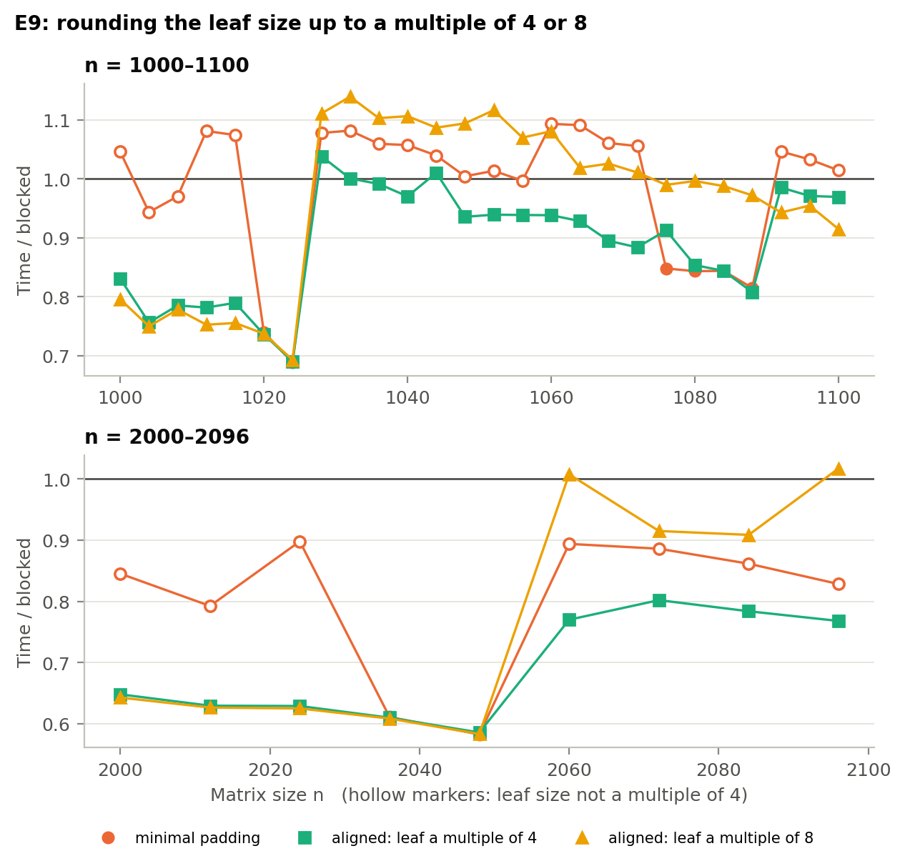
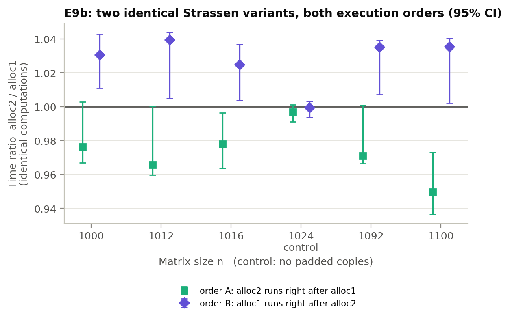

# 5. What surprised us

Three results taught us something about the algorithms (P6, P10) or about our own measurements. Each explanation was tested, not just proposed. Two tests (E9, E9b) were designed after the surprise appeared, with their predictions committed before they ran (`report/drafts/E9-preregistration.md`, `E9b-preregistration.md`).

## 5.1 The best tile is twice the "L1-sized" one, because the kernel is overhead-bound, not cache-bound

§2.4 argued that the T × T tile of B is reused across T rows, so it should fit in L1 (8T² ≤ 32 KB, so T ≤ 64). The measured optimum is T = 128 (288 KB with T = 192 in the shakedown run), and T = 64 is up to 17% slower (Figure 3). The power-of-two stride result (P8) failed for what turned out to be the same reason.

**The flaw was in what we assumed stays in L1.** In the i-k-j kernel, one inner call is `c[j] += a · b[j]` over a row segment of length T. Its live data is one row of C and one row of B: 2 × T × 8 bytes, which is 2 KB at T = 128. The rest of the B tile is re-read row by row from L2 on every i. That access is sequential, which the hardware prefetcher handles well, and L2 bandwidth easily covers one 32-byte load per vector iteration. So the tile never needs to *sit* in L1, and neither cache sets nor power-of-two conflicts between its rows ever come into play.

**What the tile size does control is how long each inner call runs.** Each call pays a fixed cost (loop set-up, the vector remainder, the branch at exit) that is amortised over T/4 vector iterations. If that is the limit, throughput should follow $F(T) = F_{\max}\, T/(T + T_0)$. We tested that claim:
- **The overhead model fits E1** for T = 8–128 with R² = 0.95 (n = 1000), 0.98 (n = 256) and 0.89 (n = 2000). The fitted overhead is T₀ ≈ 27–30 elements per call, about seven vector iterations' worth.
- **A cache explanation is inconsistent with the data.** Tiled multiplication at n = 1000 runs within 5–9% of a *single-tile* multiplication of the same width, where all data is cache-resident (T = 64: 24.5 vs 26.8 GFLOP/s; T = 128: 28.3 vs 29.7; the latter from E3 at n = T). If cache misses were the limit, the large problem would be far slower than the in-cache one.
- **The model's one systematic miss is informative.** At n = 2000 it overestimates T ≥ 96 by up to 15%, because the strip of C rows a tile row sweeps (2 MB at T = 128) no longer fits in L2. That second-order memory effect flattens the optimum.

The lesson: we reasoned about *where the data lives*, when this kernel is limited by *how much work each loop invocation gets*. A BLAS-style register-blocked micro-kernel (Goto & van de Geijn, 2008) removes exactly this overhead (§6).

## 5.2 Minimal padding loses to plain blocked at half of all sizes, because of the leaf size it chooses

`minimal` padding minimises extra arithmetic (at most 3% around n = 1000), yet over n = 1000–1100 it was slower than blocked at 14 of 26 sizes (Figure 4b). Two neighbouring sizes show the effect: n = 1020 runs at 0.74× blocked, but n = 1028, which pads by only 12 rows, runs at 1.07×. Grouping by the leaf size where the recursion stops gives a sharp split. Leaves of 128 or 68 run at 0.71–0.78× blocked; leaves of 65, 67, 69, 125 or 127 run at 1.01–1.10×.

**Hypothesis.** One AVX2 register holds 4 doubles. A leaf of width 65 leaves a scalar remainder on every row, and the temporaries' row strides (65, 130, 260… doubles) are not multiples of 4, so leaf rows are not 32-byte aligned and many vector loads straddle two cache lines.

**Test (E9, pre-registered).** We added an `aligned` padding mode that rounds the leaf up to a multiple of 4 (or 8), and swept 35 sizes in 1000–1100 and 2000–2100 (Figure 11).

*Figure 11. E9: Strassen's time relative to blocked for `minimal` padding and for leaves rounded up to multiples of 4 and 8. Hollow markers: leaf size not a multiple of 4.*

- **The core claim holds.** Rounding to a multiple of 4 cut the number of sizes where Strassen loses from 17 of 35 to 3 of 35, even though it does up to 13% more arithmetic. For leaves 125–127, rounding up to 128 saved 20–30%: n = 2024 went from 0.90× to 0.63× blocked. Across all 35 sizes, `minimal` runs at a median 0.78× blocked when its leaf is a multiple of 4, and 1.03× when it isn't.
- **H1 ("beats blocked everywhere") was partly refuted, and the residual has its own explanation, which we also checked.** Every n from 1028 to 1088 pads to the same 1088. Aligned Strassen's time is therefore flat across that range (77–85 ms), while blocked's grows as n³ (82 → 95 ms). The three remaining losses (n = 1028, 1032, 1044) are padding work, not slow flops.
- **H2 held. Alignment 8 buys nothing over 4.** Wherever it pads further (for example 1152 instead of 1088) it is 7–32% slower. Vector-width alignment is what matters, not cache-line alignment.

So the padding rule that minimises flops is close to the worst one for the vector unit. Strassen's practical cost depends on the *shape* of its leaves, which the asymptotic analysis, and our cost model, treat as free.

## 5.3 Our harness had a hidden 2–5% bias, and we could identify it

E9 produced a contradiction. At eight sizes in 1000–1100, `aligned4` and `aligned8` give *identical* computations (same leaf, same padded size, same code path), yet `aligned8` was consistently 1–6% faster, with a third of the spread. Where no padded copies are made (n = 1020, 1024, 2036, 2048), the two agreed within 0.4%. Either our order rotation was to blame, since it fixes each variant's *predecessor* (`aligned8` always ran straight after `aligned4`), or each `Plan`'s separately allocated buffers landed somewhere luckier in memory.

**E9b (pre-registered)** ran two *identical* `aligned4` variants, allocated first and second, in both execution orders, with 15 repetitions. Times were compared within each repetition (Figure 12).

*Figure 12. E9b: time ratio of two identical Strassen variants with 95% bootstrap intervals, in both execution orders. n = 1024 is the control, with no padded copies.*

- **At all five sizes with padded copies, whichever copy ran second was faster, in both orders.** That's 2.2–5.0% when the second-allocated copy ran second, and 2.5–3.9% when the first-allocated one did. The variant running right after `minimal` also had two to six times the spread.
- **Placement is ruled out.** The same allocation was never faster in both orders.
- **The control behaved as predicted:** 0.997 and 0.999, with both intervals containing 1.

**It is a carry-over effect.** A Strassen variant runs faster after a near-identical computation than after one with a different padded layout. Prefetcher, TLB or branch-predictor state are the likely carriers; we did not isolate which. So within a configuration, Strassen variants differing by less than about 5% are not distinguishable. That covers E9's `aligned8` vs `aligned4` and E5's `temp_pad`. The headline results are unaffected: E3 and E6 alternate two variants symmetrically, and the effects in E1, E2, E4 and E9 are 7% or larger.
